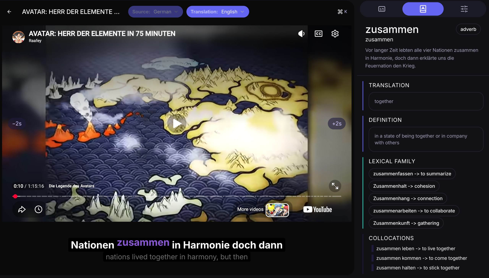
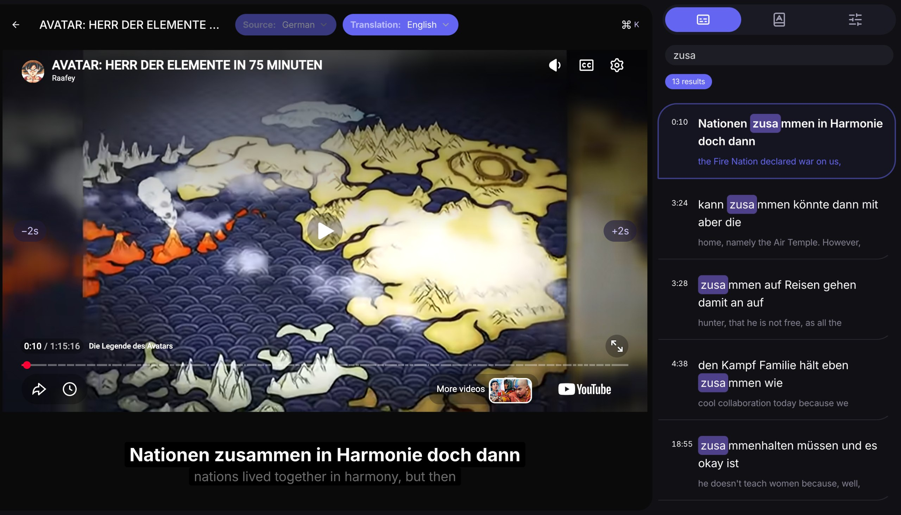
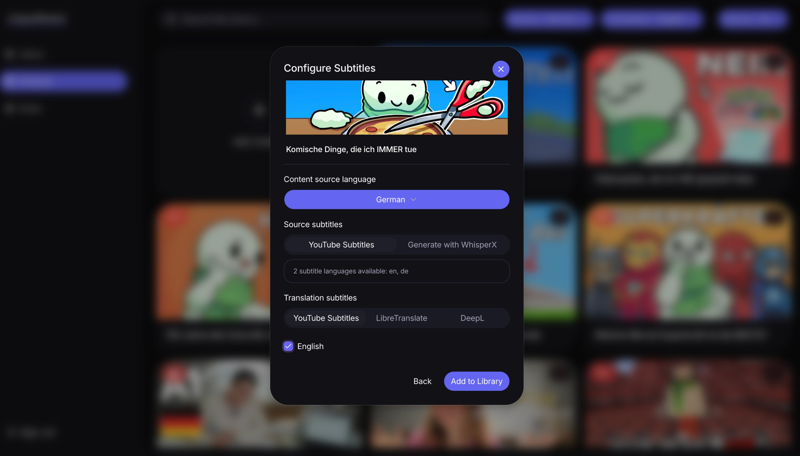
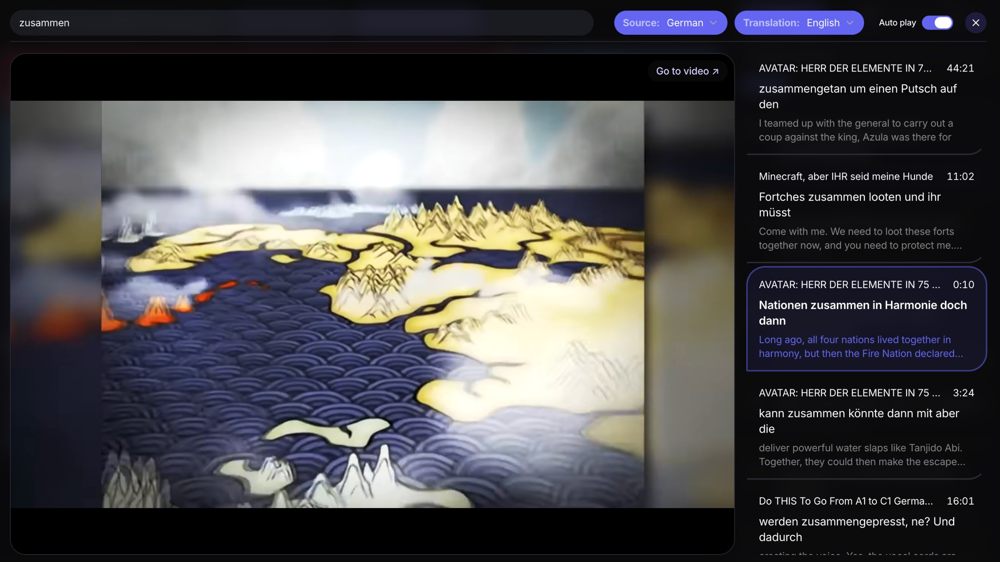
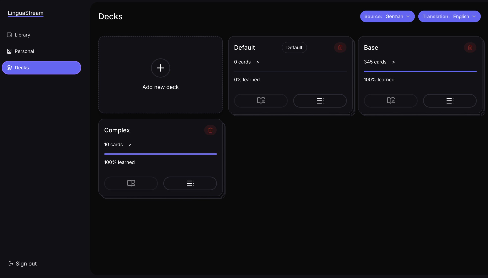
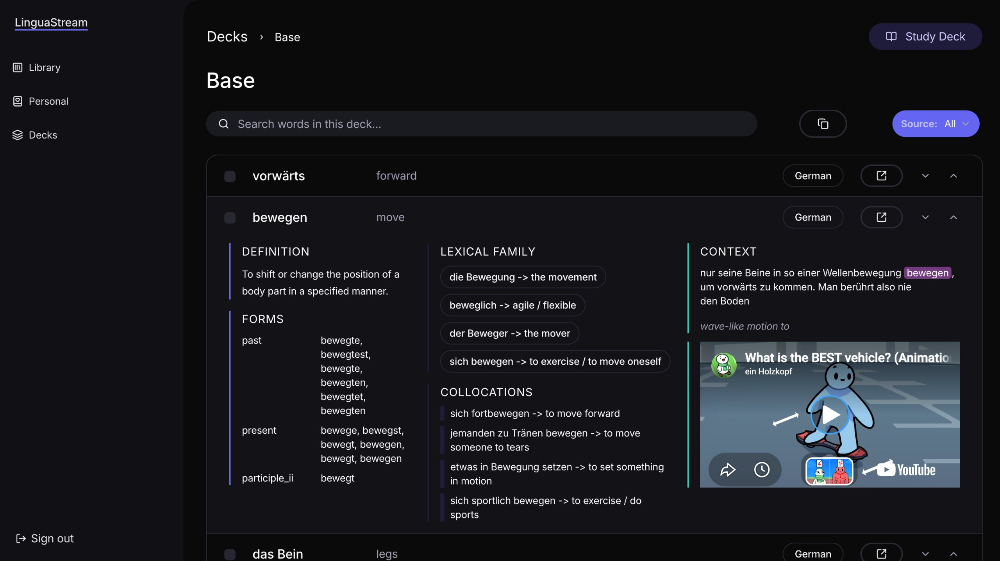

<div align="center">

# LinguaStream

**Learn languages from the videos you actually want to watch.**

A personal language-learning web app with double subtitles, clickable words, AI word profiles, spaced-repetition flashcards, and a PlayPhrase-style search across your whole library.




</div>

---

## Table of contents

- [About](#about)
- [Features](#features)
- [Screenshots](#screenshots)
- [Pages](#pages)
- [Tech stack](#tech-stack)
- [Architecture](#architecture)
- [Getting started](#getting-started)
- [Environment variables](#environment-variables)
- [Running the supporting services](#running-the-supporting-services)
- [Testing](#testing)
- [CI/CD and branching](#cicd-and-branching)
- [Roadmap](#roadmap)

---

## About

LinguaStream is a language-learning platform. You can pick a movie from your Jellyfin server or paste a YouTube link, and watch it with the original subtitles and a translation overlaid at the same time. Click any word to see what it means *in context*, then save it to a flashcard deck. Cards are scheduled with the SM-2 spaced repetition algorithm, and every card keeps a link back to the exact clip it came from.

Because every subtitle line is indexed in Meilisearch, you can also search for any word or phrase and instantly jump to every moment in your library where it was spoken.

## Features

- **Public library** - a browsable catalog of media synced from a Jellyfin server.
- **Personal library** - your private content, added via YouTube links.
- **YouTube integration** - add a video, choose its source language, and pull subtitles from YouTube.
- **Double subtitles** - original language and translation overlaid on the video, each independently toggleable.
- **Flexible subtitle sources** - YouTube captions, Jellyfin subtitle files, or local generation with WhisperX.
- **Flexible translation sources** - YouTube captions, LibreTranslate (self-hosted), or DeepL.
- **Clickable words** - every word in the subtitles is interactive and opens a word panel with a contextual translation.
- **AI word profiles** - part of speech, definition, verb/noun forms, lexical family, and collocations, generated on first access and cached.
- **Flashcard decks** - save words to decks (up to 50 per user, enforced on both client and server).
- **Spaced repetition** - SM-2 scheduling with Again / Hard / Good / Easy ratings.
- **PlayPhrase-style search** - find any word or phrase across your entire library and jump to that exact moment in the video.
- **Subtitle sidebar** - a collapsible list of all snippets, click to seek, with a local filter.

## Screenshots

### Watching and searching

| Word panel | Subtitle sidebar search |
| :---: | :---: |
|  |  |
| Click a word to get its translation, definition, lexical family, and collocations. | Filter every subtitle snippet in the video; matches are highlighted and clickable. |

### Adding content

| Configure subtitles |
| :---: |
|  |
| Choose the source language, where source subtitles come from (YouTube or WhisperX), and the translation provider (YouTube, LibreTranslate, or DeepL). |

### Global search



Search a word or phrase and get every occurrence across your library, with the original line, its translation, the video title, and the timestamp. Click a result to play that exact moment.

### Decks

| Deck list | Deck detail |
| :---: | :---: |
|  |  |
| Each deck shows its card count and learning progress. | Cards expand to show definition, forms, lexical family, collocations, subtitle context, and the original clip. |

## Pages

| Page | Description |
| --- | --- |
| **Library** | List of Jellyfin content. Search by title and filter by source and translation language. |
| **Personal** | Private library showing uploaded content only, with the same search and language filters. |
| **Decks** | All decks with name, card count, due count, and language breakdown. |
| **Deck** | Deck detail with a list of all cards. Filter by source language and search by word. Each item expands to show translation, subtitle context, verb/noun forms, lexical family, collocations. |
| **Study** | Step 1: pick a source language. Step 2: pick a deck (filtered to decks containing cards in that language). Flip the card to see the translation, subtitle context, clip button, and word profile, then rate your recall. SM-2 schedules the next review. |
| **Watch** | Media player (Plyr or YouTube IFrame depending on content type) with a two-track subtitle overlay, a collapsible and searchable subtitle sidebar. A global search bar opens a full overlay (`Cmd/Ctrl + K`). |

## Tech stack

### Frontend
- [Next.js 16](https://nextjs.org/) (App Router)
- TypeScript throughout
- Tailwind CSS + [shadcn/ui](https://ui.shadcn.com/)
- [Zustand](https://zustand-demo.pmnd.rs/) for global state and session-level caches
- [TanStack Query](https://tanstack.com/query) for server state and caching
- [Plyr](https://plyr.io/) for Jellyfin and upload playback
- YouTube IFrame API for YouTube content (with a custom subtitle overlay on top)

### Backend
- Next.js API routes (no separate server)
- [Prisma](https://www.prisma.io/) ORM (v7)
- [Zod](https://zod.dev/) for schema validation

### Data
- [Neon](https://neon.tech/) PostgreSQL
- [Meilisearch](https://www.meilisearch.com/) for full-text subtitle phrase search (runs locally)
- [Firebase Auth](https://firebase.google.com/docs/auth)

### Infrastructure and services
- [Jellyfin](https://jellyfin.org/) as the local media server
- [WhisperX](https://github.com/m-bain/whisperX) for local subtitle generation (fallback)
- [LibreTranslate](https://libretranslate.com/) for self-hosted translation
- Gemini API for word profile generation

### Testing
- [Vitest](https://vitest.dev/) for unit tests

## Getting started

### Prerequisites

- Node.js 20+ and npm (or your preferred package manager)
- A [Neon](https://neon.tech/) PostgreSQL database
- A [Firebase](https://console.firebase.google.com/) project with Authentication enabled
- A running [Jellyfin](https://jellyfin.org/) server with an API key
- [Meilisearch](https://www.meilisearch.com/docs/learn/self_hosted/getting_started_with_self_hosted_meilisearch) running locally
- Optional: WhisperX service, LibreTranslate instance

### Installation

```bash
# 1. Clone the repository
git clone https://github.com/<your-username>/<your-repo>.git
cd <your-repo>

# 2. Install dependencies
npm install

# 3. Create your environment file
cp .env.example .env.local
# ...then fill in the values (see the next section)

# 4. Generate the Prisma client and apply migrations
npx prisma generate
npx prisma migrate dev

# 5. Start the dev server
npm run dev
```

### First run checklist

1. Sign in with Firebase Auth.
2. Open **Library** and click **Sync Jellyfin** to import your Jellyfin titles.
3. Click **Reindex Subtitles** to push subtitle lines into Meilisearch so global search works.
4. Open **Personal**, click **Add Content**, and paste a YouTube link to try the YouTube flow.
5. Open any video, click a word, and add it to a deck.

## Environment variables

| Variable | Required | Description |
| --- | :---: | --- |
| `JELLYFIN_URL` | Yes | Public URL of your Jellyfin server. |
| `JELLYFIN_API_KEY` | Yes | API key created in Jellyfin under **Dashboard > API Keys**. |
| `JELLYFIN_USER_ID` | Yes | ID of the Jellyfin user whose library is synced. |
| `DATABASE_URL` | Yes | Neon PostgreSQL connection string used by Prisma. |
| `NEXT_PUBLIC_FIREBASE_API_KEY` | Yes | Firebase web app API key (from **Project settings > General**). |
| `NEXT_PUBLIC_FIREBASE_AUTH_DOMAIN` | Yes | Firebase auth domain. |
| `NEXT_PUBLIC_FIREBASE_PROJECT_ID` | Yes | Firebase project ID. |
| `NEXT_PUBLIC_FIREBASE_STORAGE_BUCKET` | Yes | Firebase storage bucket. |
| `NEXT_PUBLIC_FIREBASE_MESSAGING_SENDER_ID` | Yes | Firebase messaging sender ID. |
| `NEXT_PUBLIC_FIREBASE_APP_ID` | Yes | Firebase web app ID. |
| `FIREBASE_ADMIN_PROJECT_ID` | Yes | Project ID from your Firebase service account JSON. |
| `FIREBASE_ADMIN_CLIENT_EMAIL` | Yes | `client_email` from your Firebase service account JSON. |
| `FIREBASE_ADMIN_PRIVATE_KEY` | Yes | `private_key` from your service account JSON. Wrap it in double quotes and keep the `\n` escapes. |
| `MEILISEARCH_URL` | Yes | URL of your Meilisearch instance. |
| `MEILISEARCH_MASTER_KEY` | Yes | Master key your Meilisearch instance was started with. |
| `WHISPER_SERVICE_URL` | No | URL of your WhisperX service. Needed only for **Generate with WhisperX**. |
| `LIBRETRANSLATE_URL` | No | URL of your LibreTranslate instance. Needed only for the LibreTranslate provider. |
| `GEMINI_API_KEY` | Yes | API key for the LLM that generates word profiles. |

## Running the supporting services

Only the services you plan to use are required.

**Meilisearch**

```bash
docker run -d --name meilisearch -p 7700:7700 \
  -e MEILI_MASTER_KEY=<your-master-key> \
  -v meili_data:/meili_data \
  getmeili/meilisearch:latest
```

**LibreTranslate**

```bash
docker run -d --name libretranslate -p 5000:5000 libretranslate/libretranslate
```

**WhisperX**

Run a WhisperX HTTP service locally and point `WHISPER_SERVICE_URL` at it. It is used as a fallback when a video has no usable subtitles.

## Testing

```bash
# Run unit tests
npm test

# Run with coverage (thresholds are enforced)
npm run test:coverage
```
