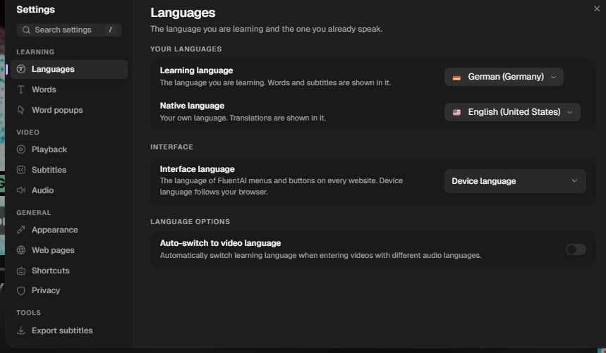

# fluentai-learning-native-interface-language

**Site:** FluentAI · **Group:** account-settings

## What it shows

FluentAI settings, Languages page.

## Settings visible

Your languages
- Learning language: German (Germany)
- Native language: English (United States)

Interface
- Interface language: Device language

Language options
- Auto-switch to video language: off (switch learning language for videos in another audio language)

## Features I like

- Design
- Separate UI language
