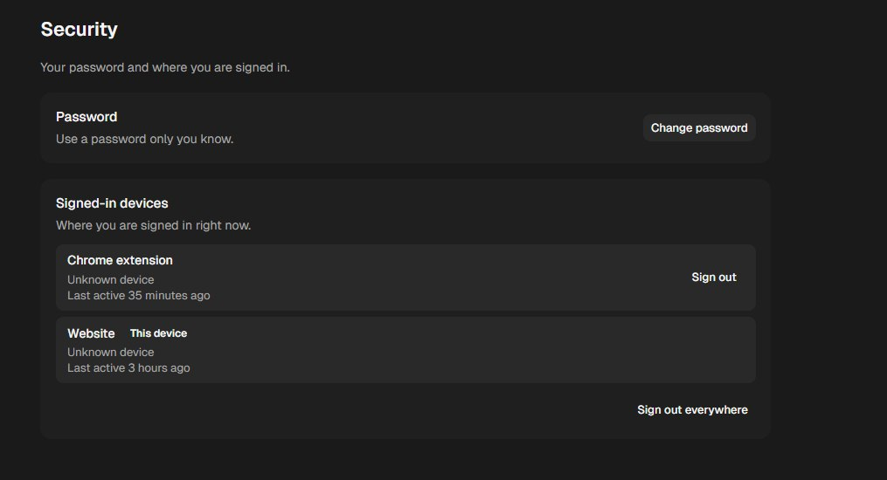

# fluentai-password-signed-in-devices

**Site:** FluentAI · **Group:** account-settings

## What it shows

Security page: your password and where you are signed in.

## Settings visible

- Password: Change password
- Signed-in devices: Chrome extension (last active 35 min ago), Sign out; Website (this device, last active 3 h ago)
- Sign out everywhere

## Features I like

- Design
- Signin tracking
