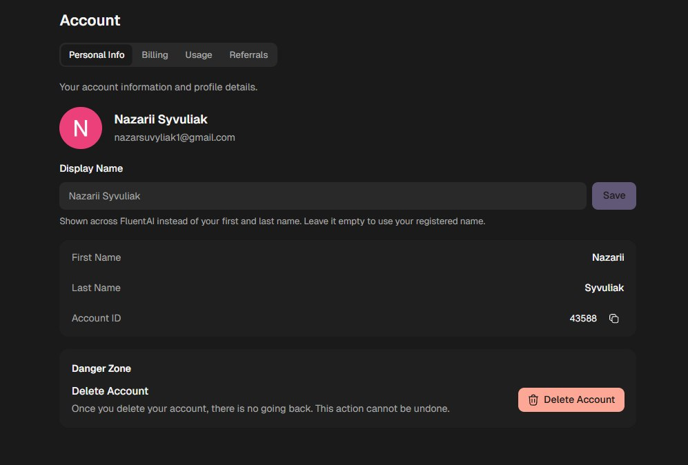

# fluentai-personal-info-delete-account

**Site:** FluentAI · **Group:** account-settings

## What it shows

Account page, Personal Info tab.

## Settings visible

- Tabs: Personal Info / Billing / Usage / Referrals
- Display name (shown instead of first and last name), Save
- First name, Last name (read-only)
- Account ID (copy)
- Danger zone: Delete account

## Features I like

- Design

