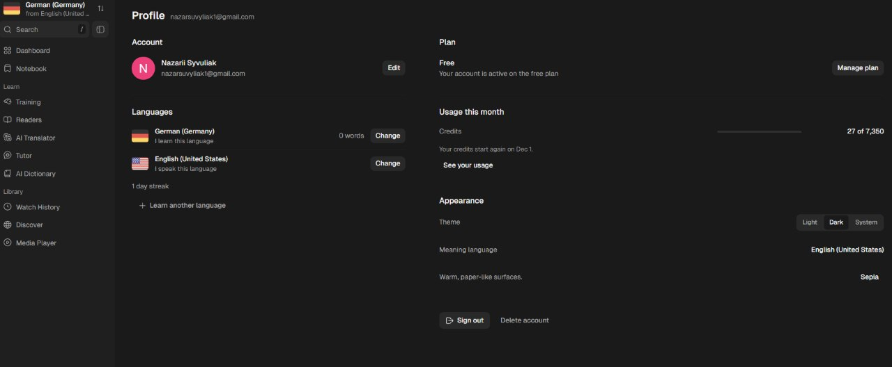

# fluentai-profile-languages-plan-theme

**Site:** FluentAI · **Group:** account-settings

## What it shows

Profile page.

## Settings visible

Account
- Name, email, Edit

Languages
- German (Germany): I learn this language, word count, Change
- English (United States): I speak this language, Change
- Day streak
- Learn another language

Plan
- Free, Manage plan

Usage this month
- Credits 27 of 7,350, resets Dec 1, See your usage

Appearance
- Theme: Light / Dark / System
- Meaning language: English (United States)
- Sepia: warm, paper-like surfaces

- Sign out
- Delete account

Sidebar navigation: Dashboard, Notebook, Training, Readers, AI Translator, Tutor, AI Dictionary, Watch History, Discover, Media Player

## Features I like

- Design
- Themes
- Usage tracking
