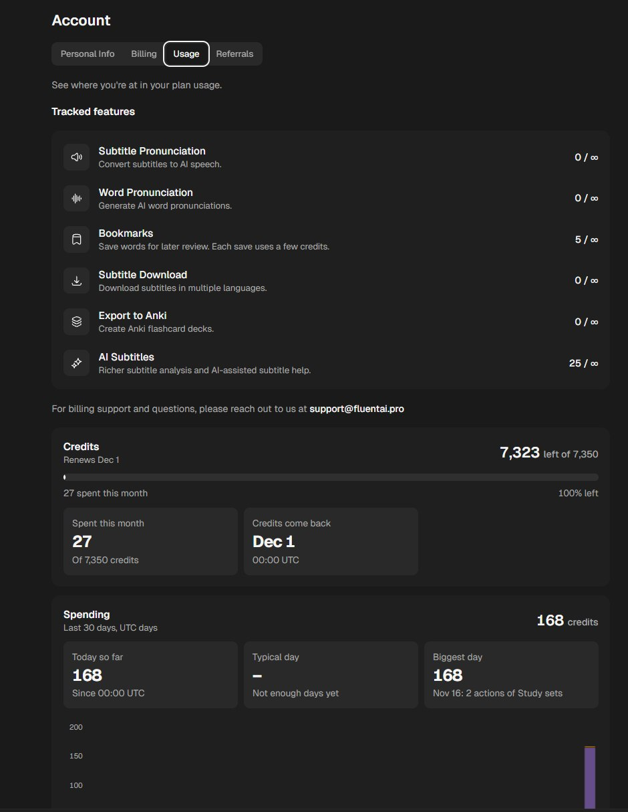

# fluentai-usage-credits-per-feature

**Site:** FluentAI · **Group:** account-settings

## What it shows

Account page, Usage tab.

## Settings visible

Tracked features (used / limit)
- Subtitle pronunciation (convert subtitles to AI speech)
- Word pronunciation
- Bookmarks (each save uses a few credits)
- Subtitle download
- Export to Anki
- AI subtitles

Credits
- 7,323 left of 7,350, renews Dec 1
- Spent this month, date credits come back

Spending (last 30 days)
- Today so far, typical day, biggest day, daily chart

## Features I like

- Design
- Tracking usage
