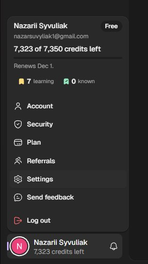

# fluentai-user-menu-credits-word-counts

**Site:** FluentAI · **Group:** account-settings

## What it shows

User menu from the sidebar.

## Settings visible

- Name, email, plan badge (Free)
- Credits left, renewal date
- Words: learning / known
- Account
- Security
- Plan
- Referrals
- Settings
- Send feedback
- Log out

## Features I like

- Design

