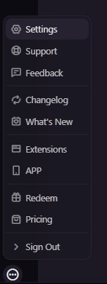

# trancy-user-menu

**Site:** Trancy · **Group:** account-settings

## What it shows

Trancy user menu.

## Settings visible

- Settings
- Support
- Feedback
- Changelog
- What's New
- Extensions
- App
- Redeem
- Pricing
- Sign Out

## Features I like

- Glass UI design
