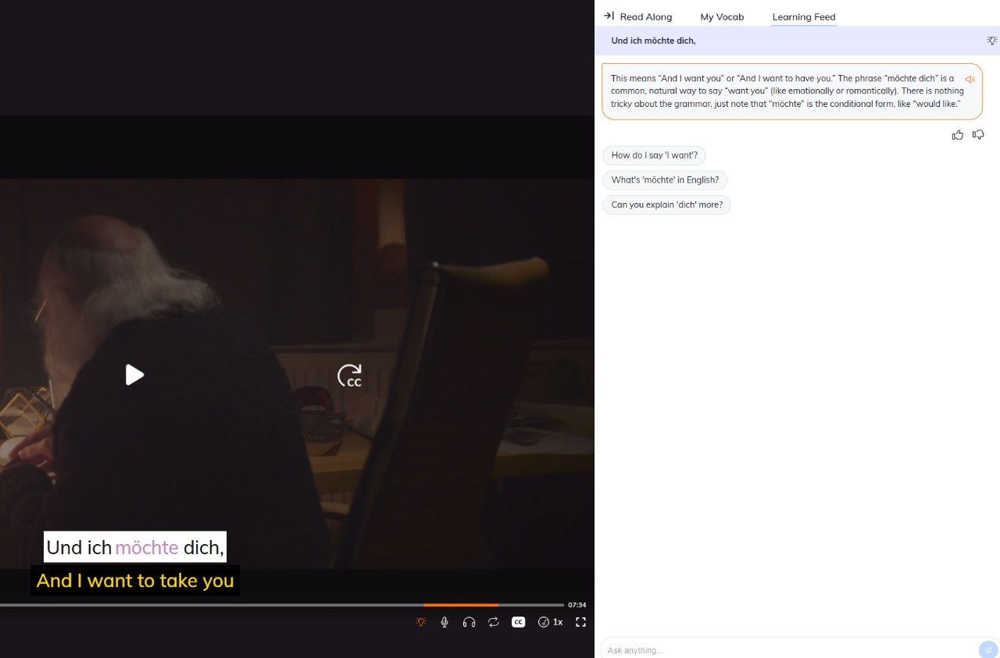

# lingopie-line-explanation-and-chat

**Site:** Lingopie · **Group:** ai-explanations

## What it shows

Learning Feed tab: AI explanation of the current subtitle line with audio, thumbs up/down, suggested follow-up questions ("How do I say 'I want'?") and an "Ask anything" chat field.

## Features I like

- AI explanations triggered by clicking on the word in the subtitles
