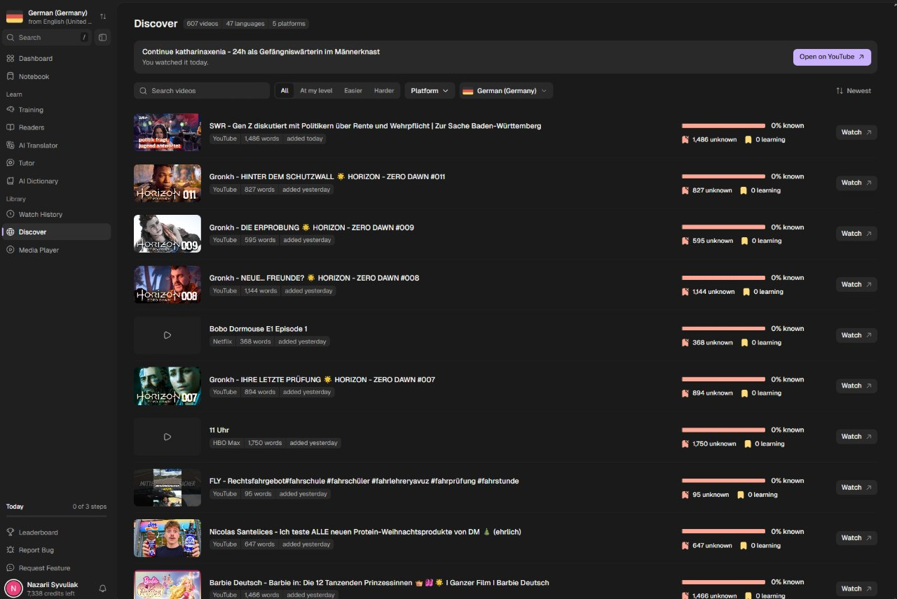

# fluentai-catalog-known-percent-per-video-difficulty-filter

**Site:** FluentAI · **Group:** discover-catalog

## What it shows

Discover page: list of videos (607 videos, 47 languages, 5 platforms) with platform, word count, date added and, per video, % known, unknown count and learning count. "Continue watching" banner at the top.

## Settings visible

- Search videos
- Difficulty: All / At my level / Easier / Harder
- Platform (dropdown)
- Language: German (Germany)
- Sort: Newest

## Features I like

- Design
- Discover by level
- Known words count
