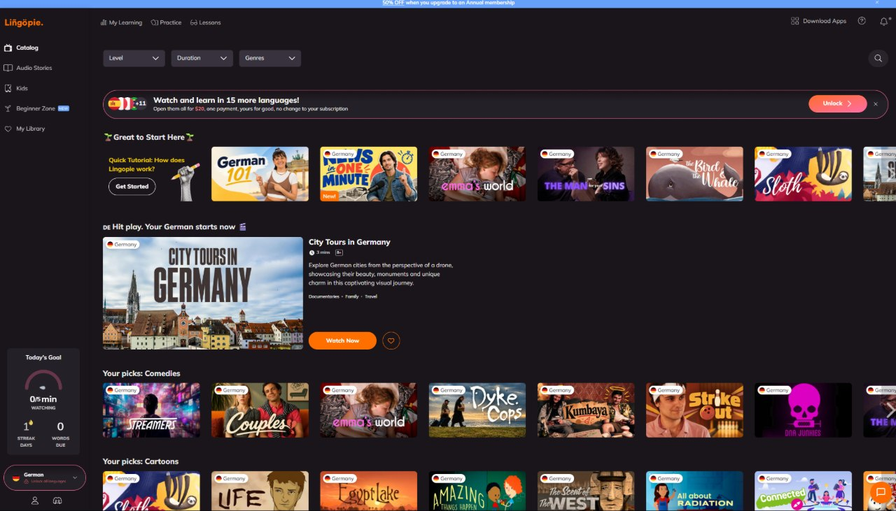

# lingopie-catalog-genre-rows-level-duration-filters

**Site:** Lingopie · **Group:** discover-catalog

## What it shows

Catalog: "Great to start here" row, featured show with description and "Watch now", rows by genre (comedies, cartoons). Sidebar: catalog, audio stories, kids, beginner zone, library; today's goal widget.

## Settings visible

- Level
- Duration
- Genres
- Search

## Features I like

- Filter by level
