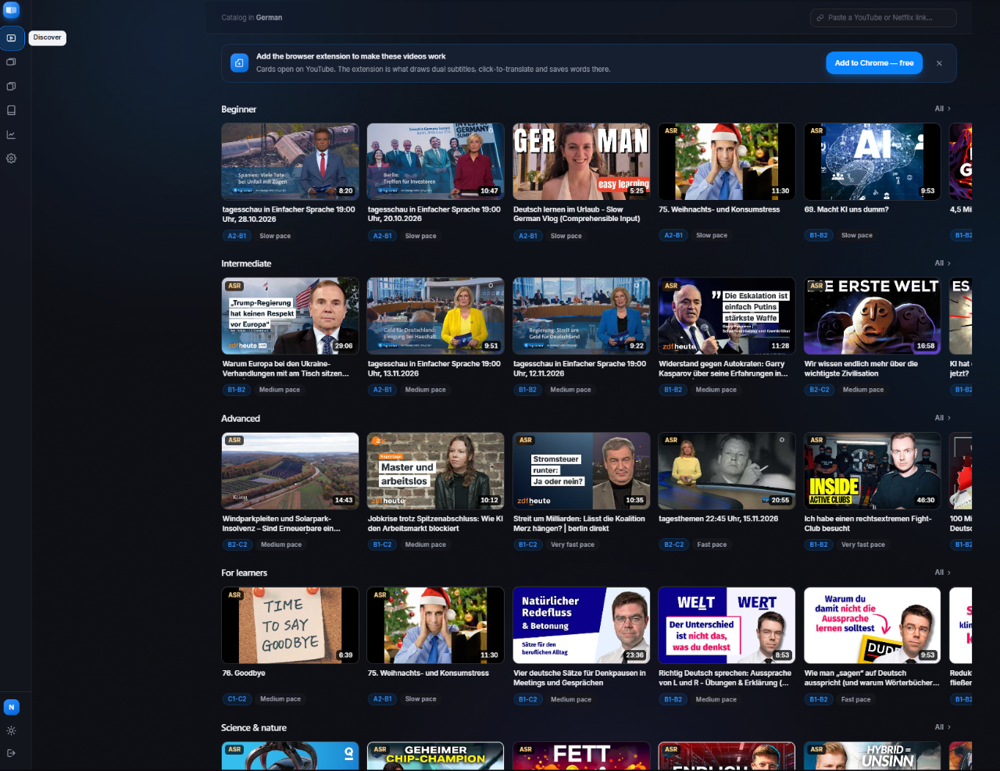

# other-catalog-by-cefr-level-and-speech-pace

**Site:** Unidentified site · **Group:** discover-catalog

## What it shows

Catalog in German, in rows: Beginner, Intermediate, Advanced, For learners, Science & nature. Each video has a CEFR range (e.g. A2–B1), speech pace (slow / medium / fast / very fast) and an ASR badge. Banner prompting to install the browser extension; field to paste a YouTube or Netflix link.

## Features I like

- A2-B2 level grading
- Design
