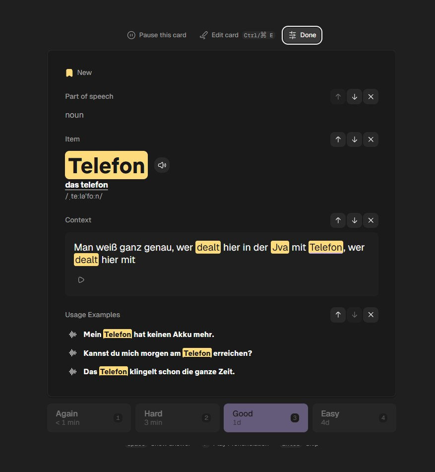

# fluentai-card-back-custom-layout

**Site:** FluentAI · **Group:** flashcard-review

## What it shows

Card back in "Customize layout" mode: sections Part of speech, Item (word, audio, article, IPA), Context (sentence + clip), Usage examples (with audio), each movable up/down or removable.

## Settings visible

- Pause this card / Edit card / Done
- Section order: part of speech, item, context, usage examples (↑ ↓ ✕ each)
- Ratings with intervals and keys 1–4

## Features I like

- Design
- Edit order of sections of delete them (should probably be hide so that they can be toggled)
