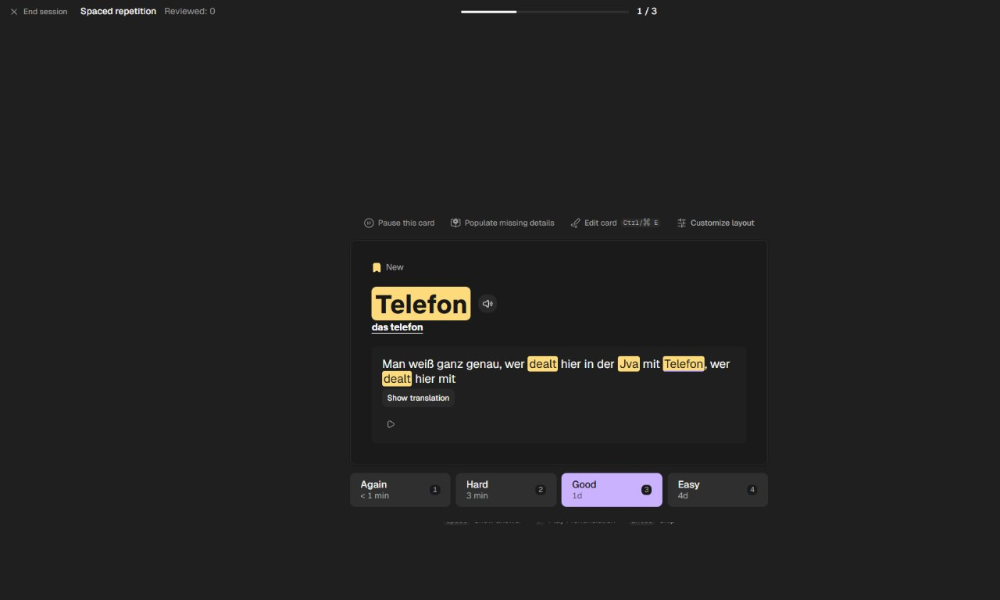

# fluentai-card-front-context-clip

**Site:** FluentAI · **Group:** flashcard-review

## What it shows

Review card front: word with audio and article, context sentence with saved words highlighted, "Show translation", play the clip; progress 1/3, reviewed count, end session.

## Settings visible

- Pause this card
- Populate missing details (AI)
- Edit card (Ctrl/⌘ E)
- Customize layout
- Ratings: Again (<1 min, 1) / Hard (3 min, 2) / Good (1 d, 3) / Easy (4 d, 4)

## Features I like

- Design
- Edit card feature
