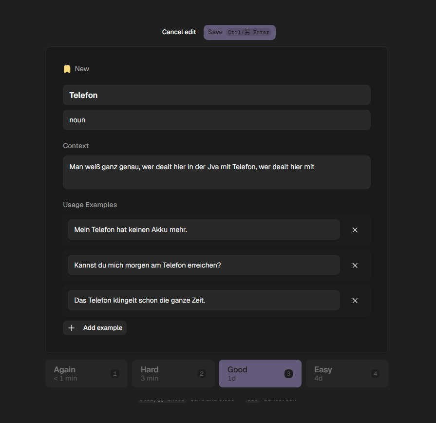

# fluentai-card-inline-edit

**Site:** FluentAI · **Group:** flashcard-review

## What it shows

Inline card editing.

## Settings visible

- Word
- Part of speech
- Context
- Usage examples (remove each, Add example)
- Cancel edit / Save (Ctrl/⌘ Enter)

## Features I like

- Design
- Editing
