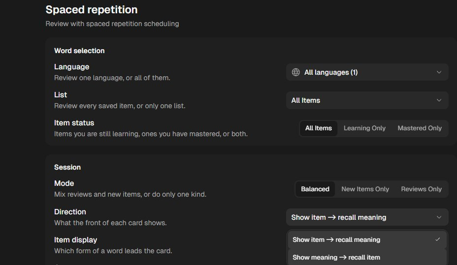

# fluentai-review-settings-mode-direction

**Site:** FluentAI · **Group:** flashcard-review

## What it shows

Spaced repetition session settings.

## Settings visible

Word selection
- Language: All languages
- List: All items
- Item status: All items / Learning only / Mastered only

Session
- Mode: Balanced / New items only / Reviews only
- Direction: Show item → recall meaning / Show meaning → recall item
- Item display: which form of a word leads the card (value cut off)

## Features I like

- Direction setting for the session
