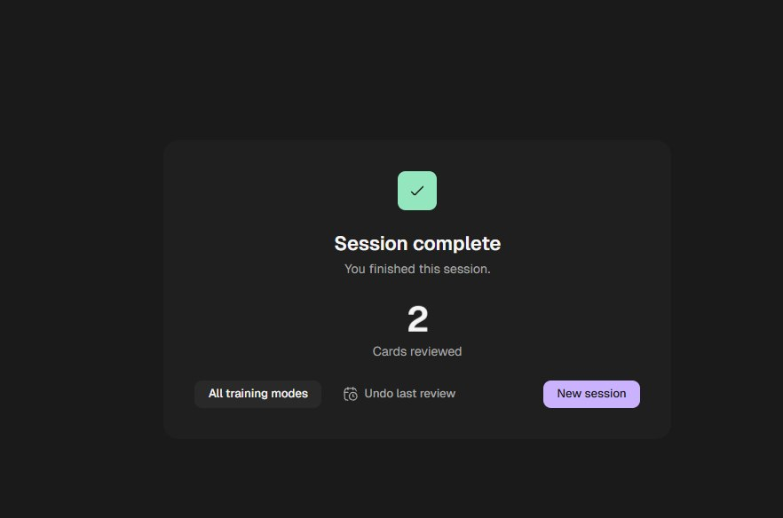

# fluentai-session-summary-undo

**Site:** FluentAI · **Group:** flashcard-review

## What it shows

"Session complete": number of cards reviewed, buttons All training modes, Undo last review, New session.

## Features I like

- Design
