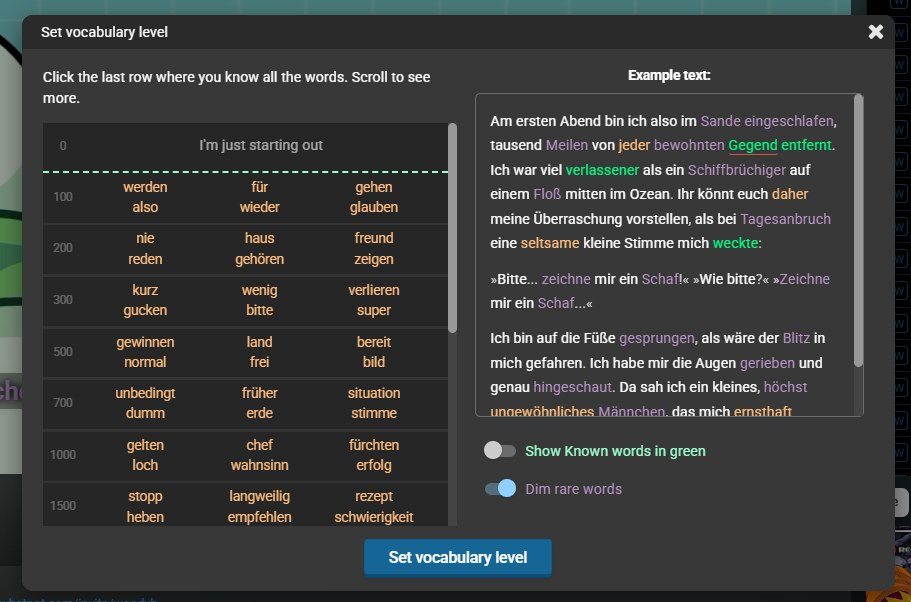

# languagereactor-placement-by-frequency-band

**Site:** Language Reactor · **Group:** onboarding-placement

## What it shows

"Set vocabulary level" modal: rows of sample words by frequency rank (0 "I'm just starting out", 100, 200, 300, 500, 700, 1000, 1500 …). Click the last row where you know all the words. Example text on the right is coloured live according to the chosen level.

## Settings visible

- Vocabulary level: click a frequency row
- Show known words in green: off
- Dim rare words: on
- Button: Set vocabulary level

## Features I like

- Quickly lets set estimated level
