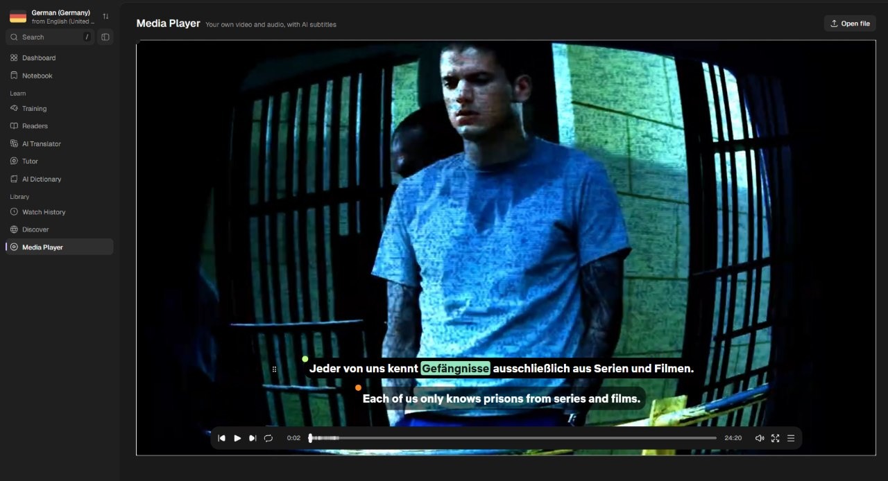

# fluentai-dual-subtitles-on-own-file

**Site:** FluentAI · **Group:** own-media

## What it shows

Own file playing with AI-generated dual subtitles; a saved word is highlighted; coloured dots mark the two tracks.

## Features I like

- Design
- PLayer controls design
- Subtitle design, colors
