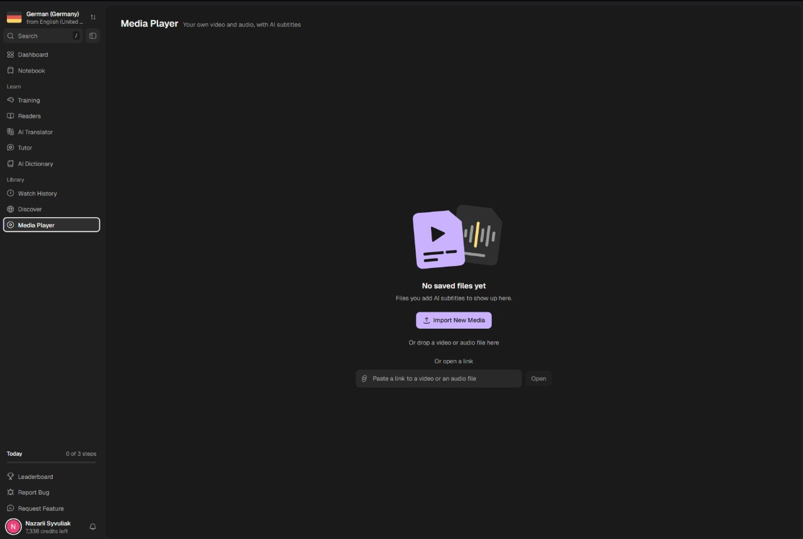

# fluentai-empty-state-import-or-link

**Site:** FluentAI · **Group:** own-media

## What it shows

Media Player empty state: "No saved files yet", Import New Media, drop a video or audio file, or paste a link.

## Features I like

- Design
- Probably out of scope, only allow upload from local files
