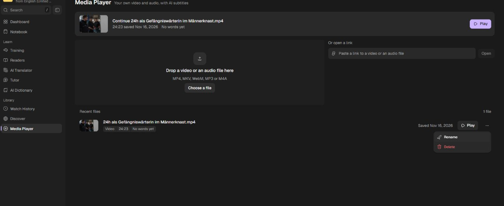

# fluentai-recent-files-menu

**Site:** FluentAI · **Group:** own-media

## What it shows

Media Player with one file: continue banner, drop zone (MP4, MKV, WebM, MP3, M4A), open a link, recent files with duration and word count, menu Rename / Delete.

## Features I like

- Design
- List of uploads
- Rename, delete and metadata
