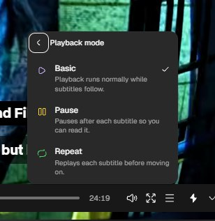

# fluentai-mode-pause-or-repeat-each-line

**Site:** FluentAI · **Group:** playback-controls

## What it shows

Playback mode submenu.

## Settings visible

- Basic (selected): playback runs normally while subtitles follow
- Pause: pauses after each subtitle so you can read it
- Repeat: replays each subtitle before moving on

## Features I like

- Design
- Different modes
