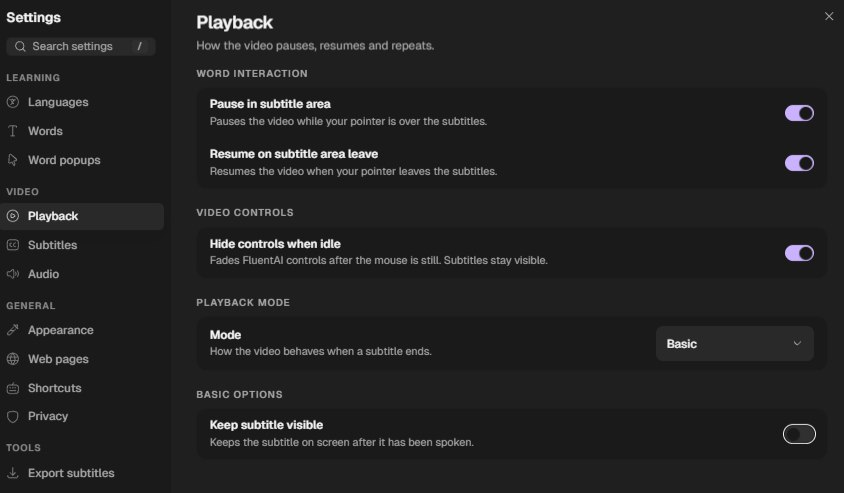

# fluentai-pause-on-subtitle-hover

**Site:** FluentAI · **Group:** playback-controls

## What it shows

FluentAI settings, Playback page: how the video pauses, resumes and repeats.

## Settings visible

Word interaction
- Pause in subtitle area: on (pauses while the pointer is over the subtitles)
- Resume on subtitle area leave: on

Video controls
- Hide controls when idle: on (subtitles stay visible)

Playback mode
- Mode: Basic (how the video behaves when a subtitle ends)

Basic options
- Keep subtitle visible: off (keeps the subtitle on screen after it has been spoken)

## Features I like

- Design
- Pause and resume features
- Hide controls when idle
- Playback modes

## Features I DONT like

- Keep subtitle visible
