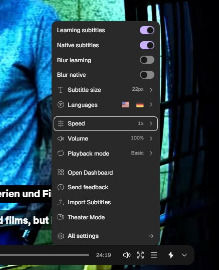

# fluentai-player-quick-menu

**Site:** FluentAI · **Group:** playback-controls

## What it shows

Quick menu opened from FluentAI's player controls.

## Settings visible

- Learning subtitles: on
- Native subtitles: on
- Blur learning: off
- Blur native: off
- Subtitle size: 22px
- Languages: English / German
- Speed: 1x
- Volume: 100%
- Playback mode: Basic
- Open Dashboard
- Send feedback
- Import Subtitles
- Theater Mode
- All settings

## Features I like

- Subtitle toggle
- Blur toggle
- All of the settings except for Theater Mode(should be separate icon), Import Subtitles, Send feedback, Open Dashboard
