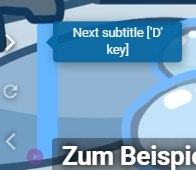

# languagereactor-next-subtitle-key

**Site:** Language Reactor · **Group:** playback-controls

## What it shows

Subtitle navigation buttons beside the player: previous, repeat, next. Tooltip: "Next subtitle ['D' key]".

## Features I like

- Skip and rewind subtitle line
