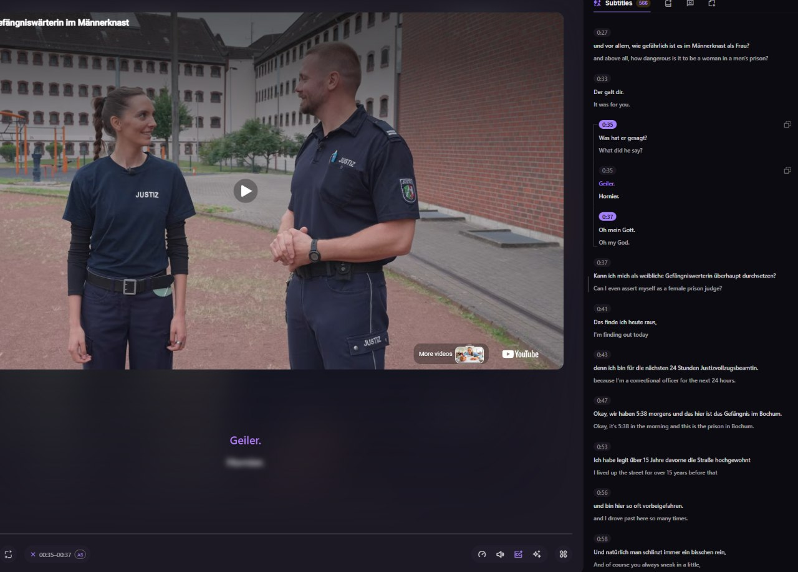

# trancy-ab-loop-active

**Site:** Trancy · **Group:** playback-controls

## What it shows

Active loop 0:35–0:37: the looped lines are marked in the transcript, the range shows in the control bar with a button to clear it.

## Features I like

- Selecting replay loop
- PLayer controls design
