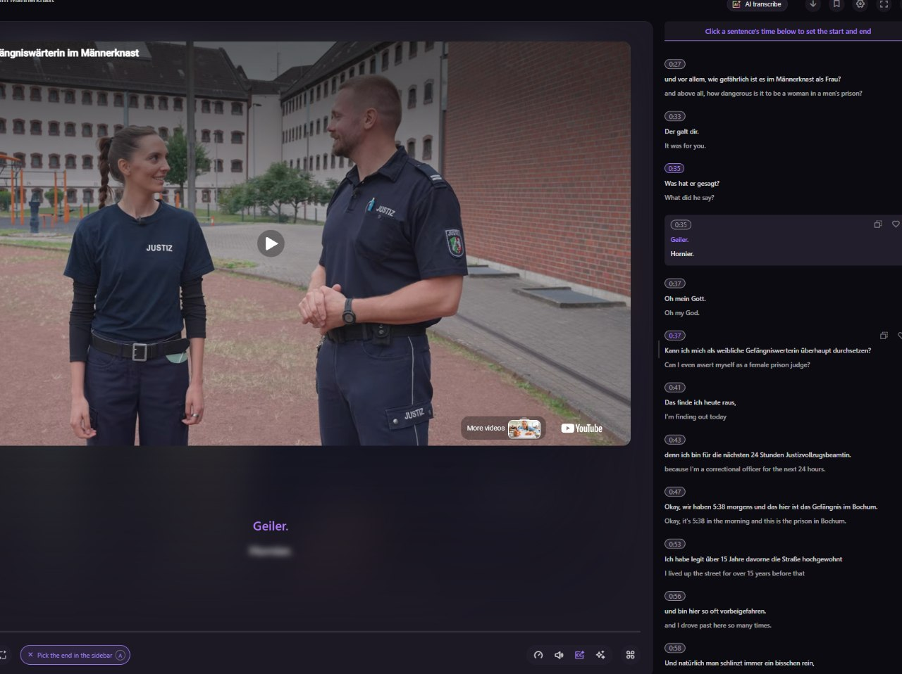

# trancy-ab-loop-pick-lines

**Site:** Trancy · **Group:** playback-controls

## What it shows

A–B loop: "Click a sentence's time below to set the start and end"; the control bar shows "Pick the end in the sidebar".

## Features I like

- Selecting replay loop
- PLayer controls design
