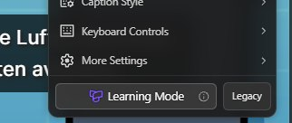

# trancy-youtube-learning-mode-handoff-button

**Site:** Trancy · **Group:** playback-controls

## What it shows

Menu in Trancy's controls inside the YouTube player, with a button that opens the video in Trancy's own learning player.

## Settings visible

- Caption Style
- Keyboard Controls
- More Settings
- Learning Mode (button, opens the full learning player)
- Legacy

## Features I like

- Button that triggers transfer
