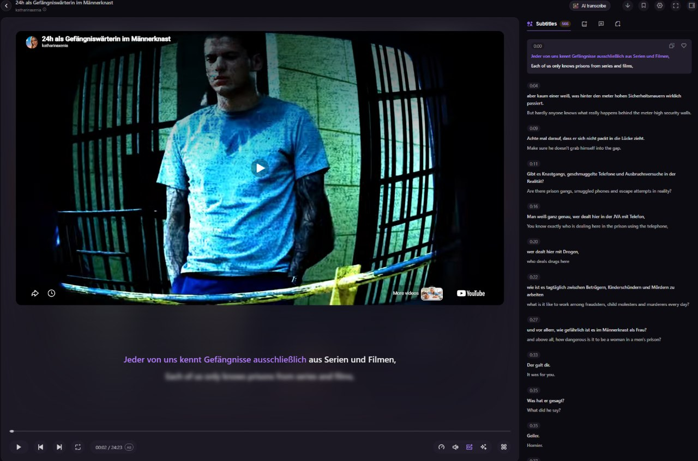

# trancy-player-with-transcript-sidebar

**Site:** Trancy · **Group:** player-layout

## What it shows

Trancy's own player page for a YouTube video: embedded player, large dual subtitles below it (translation blurred), transcript sidebar with timestamps and translation per line, copy / save on the current line. Top bar: AI transcribe, download, bookmark, settings, fullscreen, sidebar toggle.

## Features I like

- General layout
