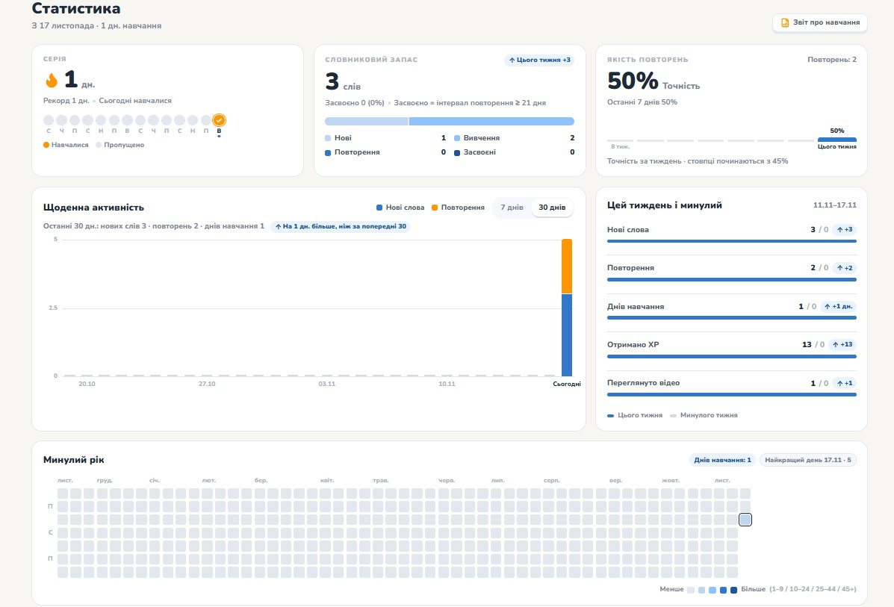

# tubevocab-streak-accuracy-activity-heatmap

**Site:** TubeVocab · **Group:** progress-stats

## What it shows

Statistics page (Ukrainian): streak with week dots and record, vocabulary size by stage (new, learning, review, mastered; mastered = interval ≥ 21 days), review accuracy with weekly bars, daily activity chart (new words vs reviews, 7/30 days), this week vs last week (new words, reviews, study days, XP, videos watched), past-year heatmap, learning report button.

## Features I like

- Stats? probably out of scope
