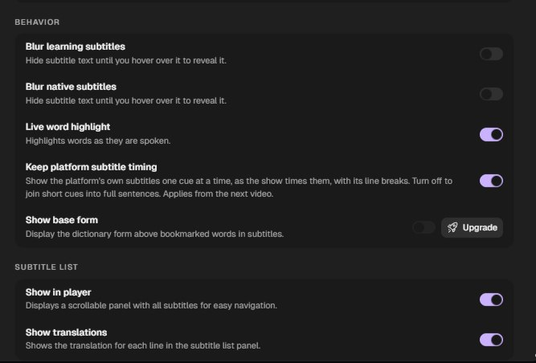

# fluentai-blur-live-highlight-join-cues

**Site:** FluentAI · **Group:** subtitle-display

## What it shows

FluentAI settings, Behavior and Subtitle list sections.

## Settings visible

Behavior
- Blur learning subtitles: off
- Blur native subtitles: off
- Live word highlight: on
- Keep platform subtitle timing: on (turn off to join short cues into full sentences)
- Show base form: off, paid

Subtitle list
- Show in player: on (scrollable panel with all subtitles)
- Show translations: on (translation for each line in the list)

## Features I like

- Blur
- Live word highlight (or read along)
