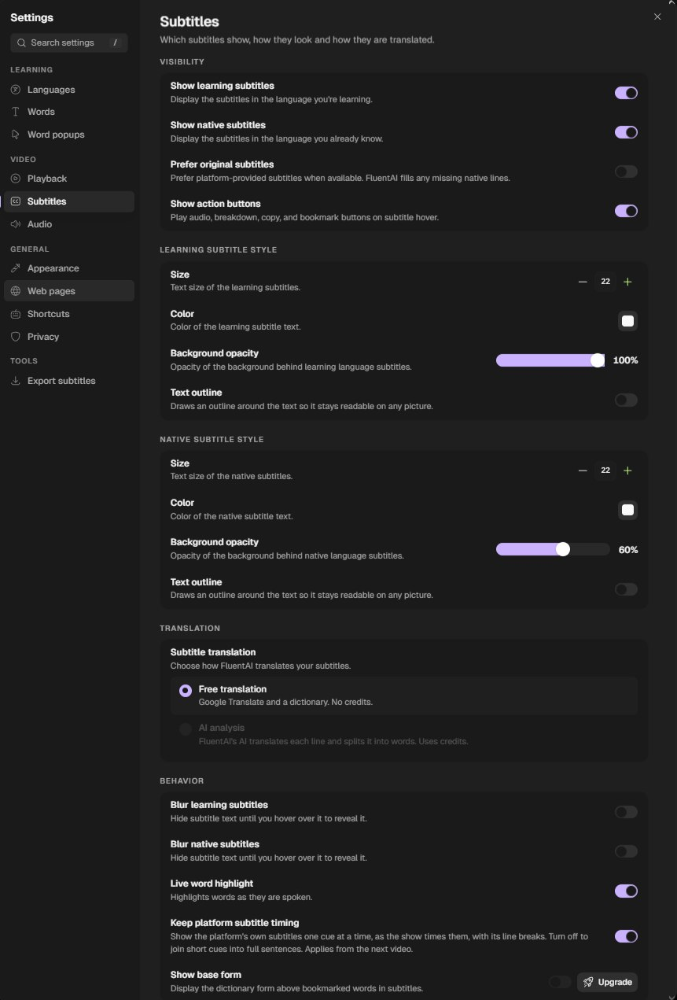

# fluentai-subtitle-settings-visibility-style-translation

**Site:** FluentAI · **Group:** subtitle-display

## What it shows

FluentAI settings modal, Subtitles page: which subtitles show, how they look and how they are translated.

## Settings visible

Settings navigation: Learning (Languages, Words, Word popups) · Video (Playback, Subtitles, Audio) · General (Appearance, Web pages, Shortcuts, Privacy) · Tools (Export subtitles) · Search settings

Visibility
- Show learning subtitles: on
- Show native subtitles: on
- Prefer original subtitles: off ("Prefer platform-provided subtitles when available. FluentAI fills any missing native lines.")
- Show action buttons: on (play audio, breakdown, copy and bookmark buttons on subtitle hover)

Learning subtitle style
- Size: 22 (−/+)
- Color: white
- Background opacity: 100%
- Text outline: off

Native subtitle style
- Size: 22
- Color: white
- Background opacity: 60%
- Text outline: off

Translation
- Subtitle translation: Free translation (Google Translate and a dictionary, no credits), selected / AI analysis (AI translates each line and splits it into words, uses credits), disabled

Behavior
- Blur learning subtitles: off (hide text until hover)
- Blur native subtitles: off
- Live word highlight: on (highlights words as they are spoken)
- Keep platform subtitle timing: on (off joins short cues into full sentences; applies from the next video)
- Show base form: off, paid (dictionary form above bookmarked words)

## Features I like

- Subtitle track toggle (Show learning subtitles, Show native subtitles)
- Show action buttons: on (play audio, breakdown, copy and bookmark buttons on subtitle hover)
- Subtitle customisations (but missing background color and subtitle opacity)
- Translation engine
- Blur
