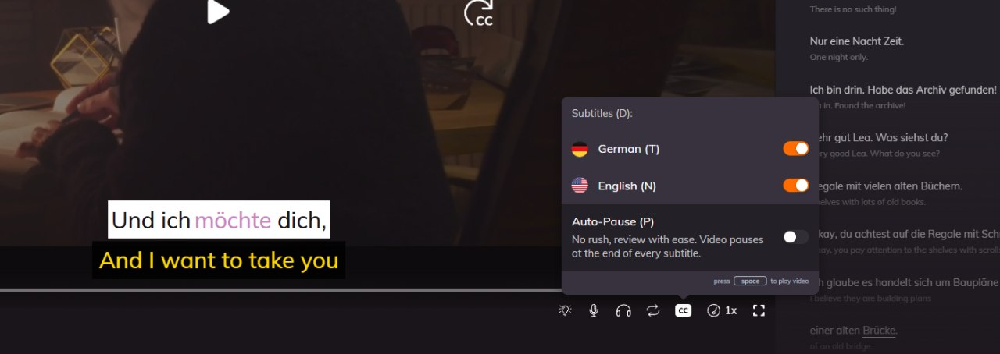

# lingopie-subtitle-toggles-auto-pause-shortcuts

**Site:** Lingopie · **Group:** subtitle-display

## What it shows

Subtitle popover on Lingopie's player, with keyboard shortcuts in brackets. Control bar: explain (bulb), speak (mic), listen, loop, CC, speed, fullscreen. Transcript on the right.

## Settings visible

Subtitles (D)
- German (T): on
- English (N): on
- Auto-Pause (P): off ("Video pauses at the end of every subtitle")
- Space: play video
- Speed: 1x

## Features I like

- Tracks toggle on player controls panel 
