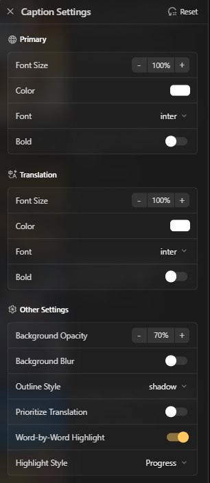

# trancy-caption-style-per-track

**Site:** Trancy · **Group:** subtitle-display

## What it shows

Caption Settings panel in the YouTube player (extension).

## Settings visible

Primary
- Font size: 100% (−/+)
- Color: white
- Font: inter
- Bold: off

Translation
- Font size: 100%
- Color: white
- Font: inter
- Bold: off

Other settings
- Background opacity: 70%
- Background blur: off
- Outline style: shadow
- Prioritize translation: off
- Word-by-word highlight: on
- Highlight style: Progress
- Reset

## Features I like

- Design
- Customisations
- Word-by-word highlight options and style (or read along)
