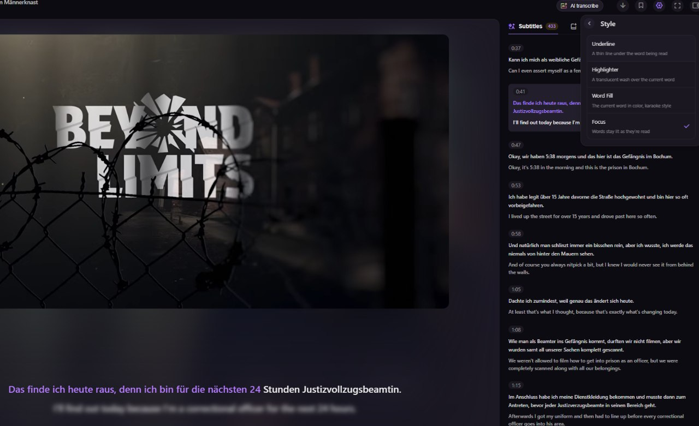

# trancy-read-along-highlight-styles

**Site:** Trancy · **Group:** subtitle-display

## What it shows

Style options for the read-along highlight, shown over the player page.

## Settings visible

Style
- Underline: a thin line under the word being read
- Highlighter: a translucent wash over the current word
- Word Fill: the current word in colour, karaoke style
- Focus (selected): words stay lit as they're read

## Features I like

- Read along style options (or word-by-word highlight)