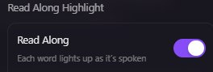

# trancy-read-along-toggle

**Site:** Trancy · **Group:** subtitle-display

## What it shows

Read Along Highlight setting.

## Settings visible

- Read Along: on ("Each word lights up as it's spoken")

## Features I like

- Read along (or word-by-word highlight)
