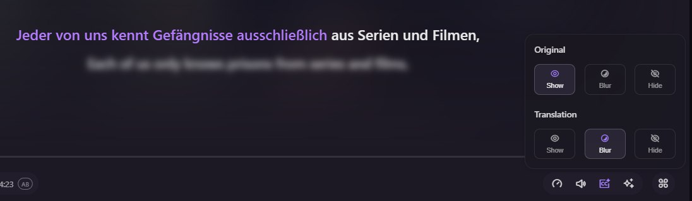

# trancy-show-blur-hide-per-track

**Site:** Trancy · **Group:** subtitle-display

## What it shows

Popover from the subtitle button: visibility per track.

## Settings visible

- Original: Show (selected) / Blur / Hide
- Translation: Show / Blur (selected) / Hide

## Features I like

- Player control design
- This is the best way to select language track visibility
