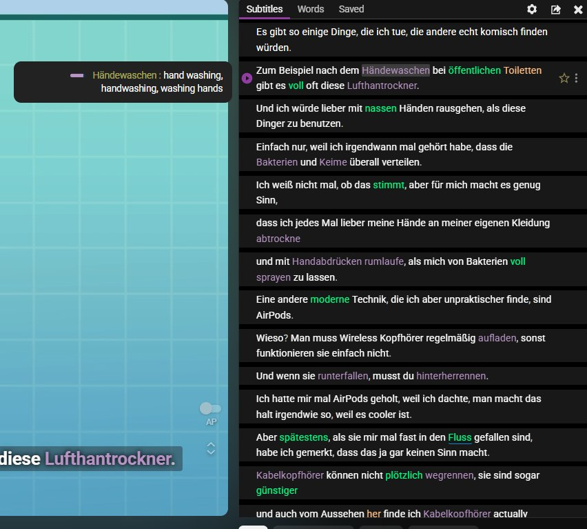

# languagereactor-transcript-colored-words-hover-gloss

**Site:** Language Reactor · **Group:** transcript-panel

## What it shows

Subtitles tab of the sidebar: every line with words coloured by status (known green, learning orange, unknown purple), hover gloss on a word, current line with play, star and more menu. Tabs: Subtitles, Words, Saved.

## Features I like

- Colored words
- Translation popup of the left on word hover

## Features I DONT like

- Design
