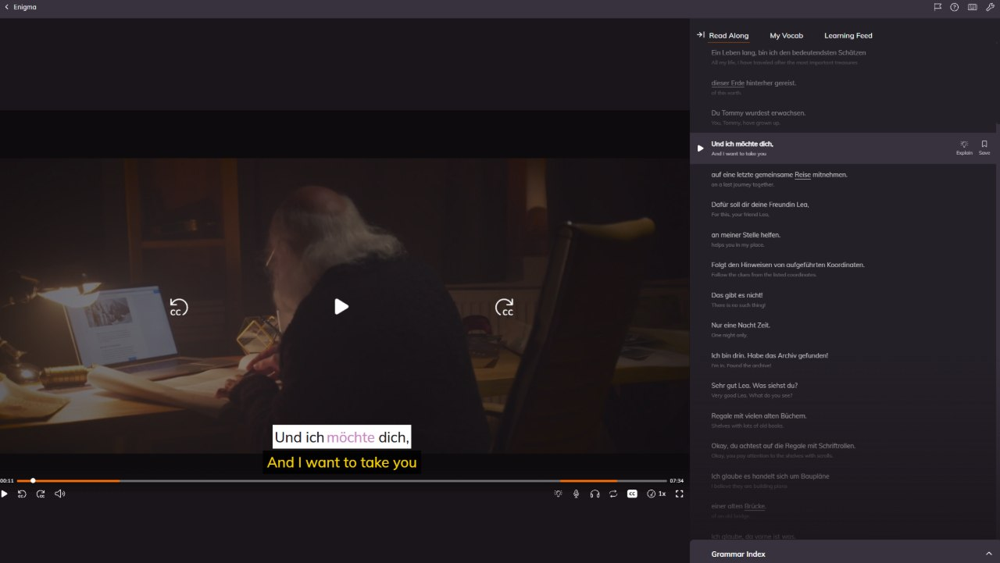

# lingopie-read-along-explain-save-grammar-index

**Site:** Lingopie · **Group:** transcript-panel

## What it shows

Read Along tab: transcript with translations, current line highlighted with Explain and Save buttons, underlined saved words, Grammar Index section at the bottom. Player has back / forward one subtitle buttons. Tabs: Read Along, My Vocab, Learning Feed.

## Features I like

- Design
- Explain (which triggers AI explaining)

## Features I DONT like

- Subtitle track design
- No word highlight on the subtitle list
