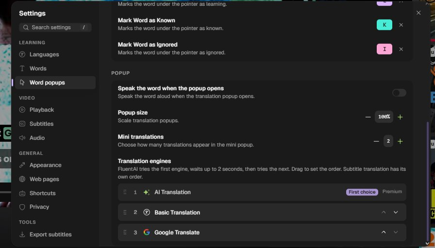

# fluentai-engine-fallback-order-status-keys

**Site:** FluentAI · **Group:** translation-sources

## What it shows

FluentAI settings, Word popups page (lower part).

## Settings visible

Keys
- Mark word as learning: L
- Mark word as known: K
- Mark word as ignored: I

Popup
- Speak the word when the popup opens: off
- Popup size: 100%
- Mini translations: 2

Translation engines (tries the first, waits up to 2 s, then the next; drag to reorder; subtitle translation has its own order)
1. AI Translation (first choice, premium)
2. Basic Translation
3. Google Translate

## Features I like

- Key shortcuts (last in order, out of scope)
- Translation engine 
- Popup size 
- Design
- Form input with buttons (plus, minus) and enterable at the same time

## Features I DONT like

- AI voice
