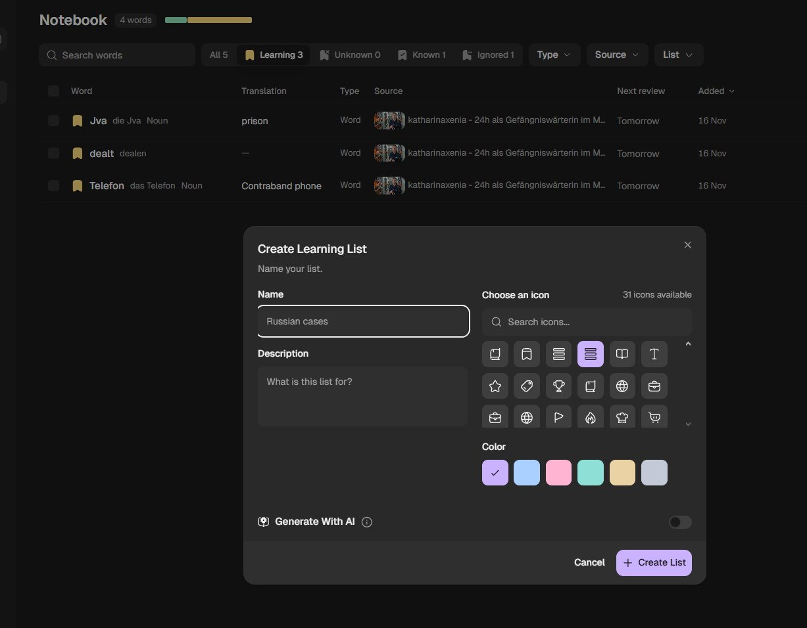

# fluentai-create-list-icon-color-ai

**Site:** FluentAI · **Group:** vocabulary-notebook

## What it shows

"Create Learning List" modal over the notebook.

## Settings visible

- Name
- Description ("What is this list for?")
- Icon: 31 icons, searchable
- Color: 6 options
- Generate with AI: off
- Cancel / Create list

## Features I like

- Design
- List with icon and color creation
