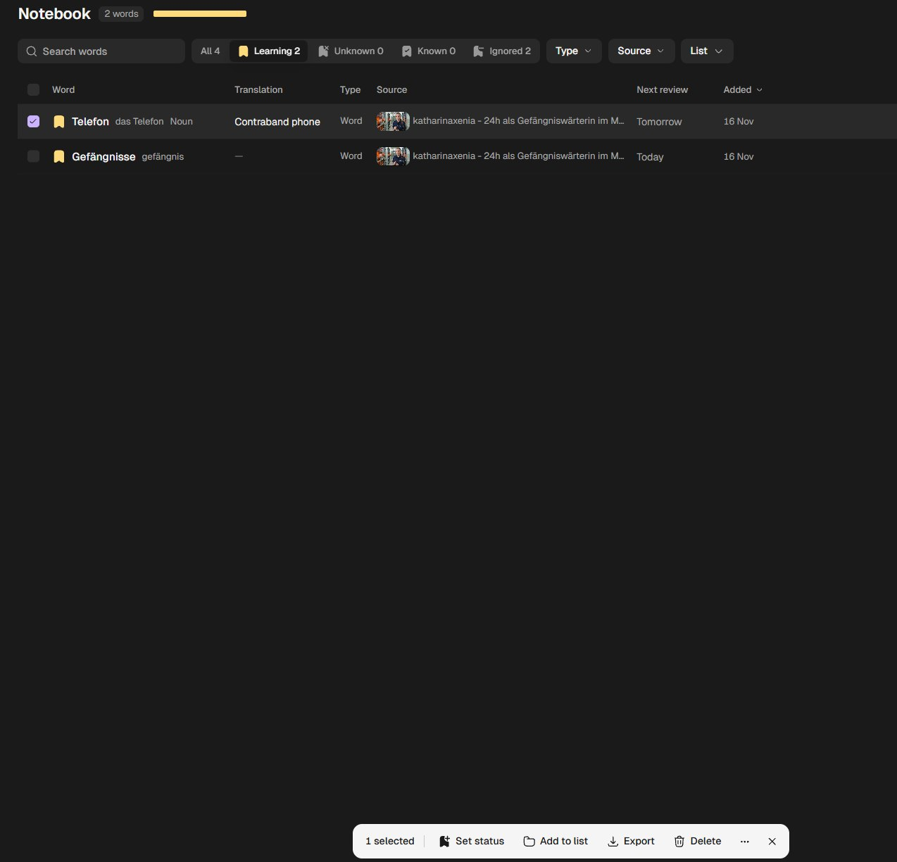

# fluentai-notebook-bulk-actions

**Site:** FluentAI · **Group:** vocabulary-notebook

## What it shows

Notebook with one word selected: bulk action bar.

## Settings visible

- Set status
- Add to list
- Export
- Delete
- More (…)

## Features I like

- Actions popup
