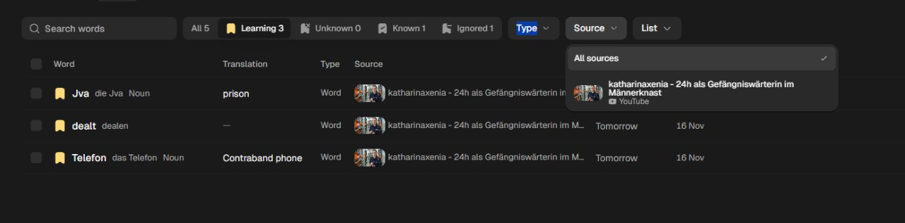

# fluentai-notebook-filter-by-video

**Site:** FluentAI · **Group:** vocabulary-notebook

## What it shows

Notebook Source filter open: All sources, or one specific video (with thumbnail and platform).

## Features I like

- Design
- Filter by source, word stage (known, learning...), query and list
