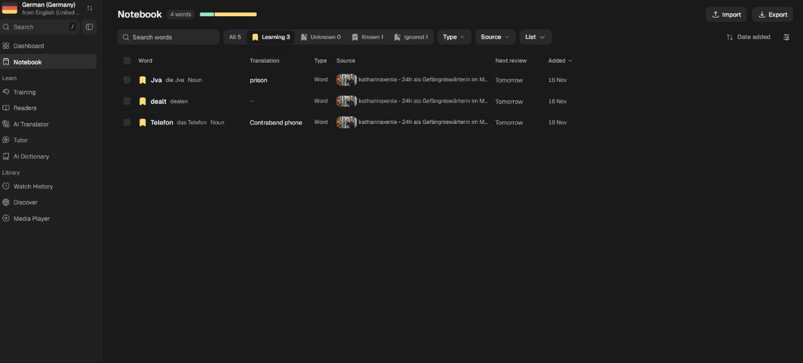

# fluentai-notebook-status-tabs-source

**Site:** FluentAI · **Group:** vocabulary-notebook

## What it shows

Notebook (saved words): word with article and POS, translation, type, source video with thumbnail, next review, date added. Import and Export buttons.

## Settings visible

- Search words
- Status: All / Learning / Unknown / Known / Ignored
- Type, Source, List (dropdowns)
- Sort: Date added
- Column settings

## Features I like

- Design
- Filter by source, word stage (known, learning...), query and list
