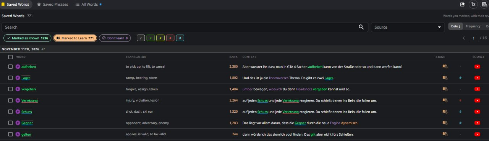

# languagereactor-saved-words-rank-context-tags

**Site:** Language Reactor · **Group:** vocabulary-notebook

## What it shows

Saved Words table grouped by date: word with audio, translations, frequency rank, context sentence with coloured words, stage, tag, source (YouTube).

## Settings visible

- Tabs: Saved Words / Saved Phrases / All Words
- Search, Source filter
- Sort: Date / Frequency / …
- Status: Marked as Known 1236 / Marked to Learn 771 / Don't learn 0
- Tag filters
- Pagination

## Features I like

- Sort by date, frequency
- Filter by word stage (known, learning...), query
- Link to source
- Word highlight in context
- Saved context

## Features I DONT like

- Design
