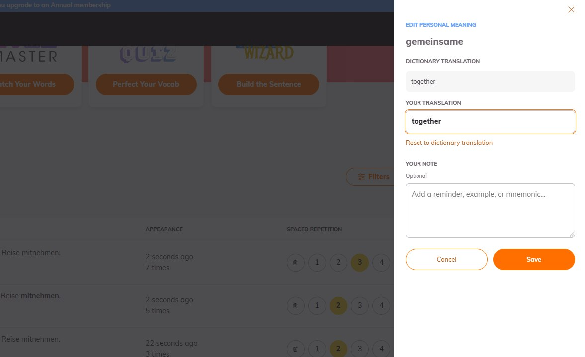

# lingopie-edit-personal-translation-note

**Site:** Lingopie · **Group:** vocabulary-notebook

## What it shows

"Edit personal meaning" panel.

## Settings visible

- Dictionary translation (read-only)
- Your translation
- Reset to dictionary translation
- Your note (optional: reminder, example or mnemonic)
- Cancel / Save

## Features I like

- Words are editable
