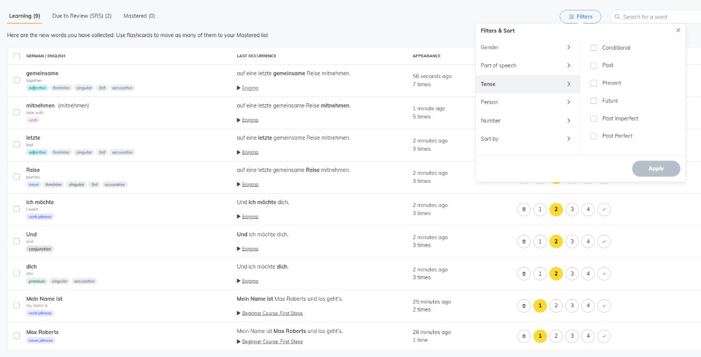

# lingopie-filter-by-grammar-features

**Site:** Lingopie · **Group:** vocabulary-notebook

## What it shows

Filters & Sort panel on the vocabulary list.

## Settings visible

- Gender
- Part of speech
- Tense: Conditional, Past, Present, Future, Past Imperfect, Past Perfect
- Person
- Number
- Sort by
- Apply

## Features I like

- Filter bu Tense, Gender, Number, PoS and Person?
