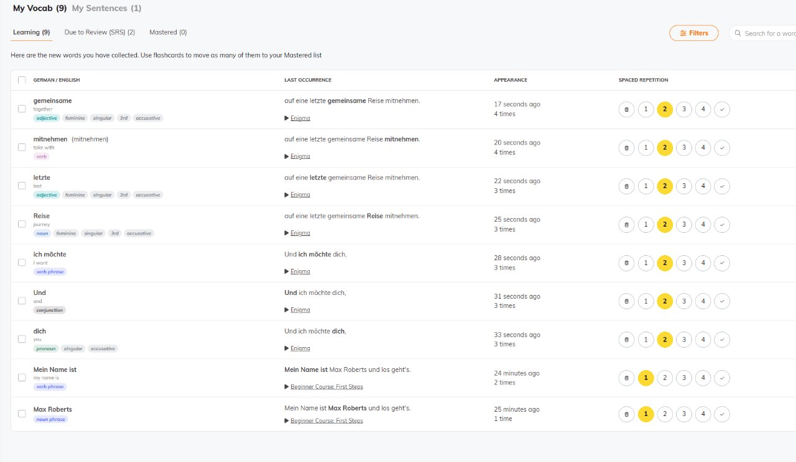

# lingopie-vocab-srs-stage-buttons

**Site:** Lingopie · **Group:** vocabulary-notebook

## What it shows

My Vocab / My Sentences: words and phrases with gloss and grammar tags, last occurrence sentence with a link to the show, appearance (last seen, count), spaced-repetition stage buttons (delete, 1–4, mastered).

## Settings visible

- Tabs: Learning / Due to Review (SRS) / Mastered
- Filters
- Search

## Features I like

- Spaced repetition column with easy transer to next stage (maybe should be implemented in a different way)
