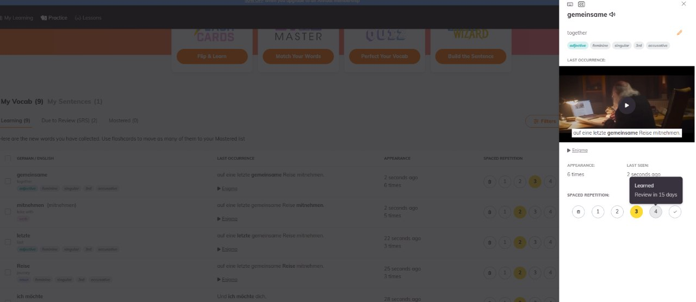

# lingopie-word-detail-clip-practice-games

**Site:** Lingopie · **Group:** vocabulary-notebook

## What it shows

Word detail over the vocabulary page: translation, grammar tags, clip of the last occurrence, appearance count, last seen, SRS stage with tooltip "Learned – Review in 15 days". Behind it: practice games Flash Cards (Flip & Learn), Match Your Words, Quiz (Perfect Your Vocab), Build the Sentence.

## Features I like

- Spaced repetition column with easy transer to next stage (maybe should be implemented in a different way)
- Edit button
