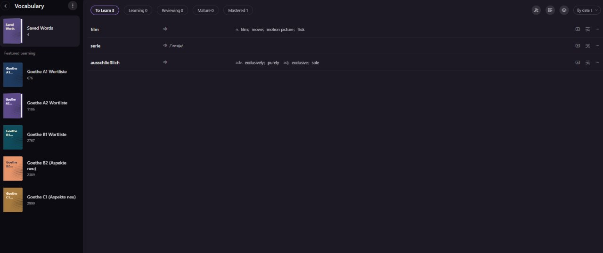

# trancy-goethe-word-lists-srs-stages

**Site:** Trancy · **Group:** vocabulary-notebook

## What it shows

Vocabulary page: Saved Words plus featured lists Goethe A1 (676), A2 (1186), B1 (2767), B2 (2389), C1 (2999). Words with audio, IPA, POS glosses and actions (play clip, look up, more).

## Settings visible

- Stage tabs: To Learn / Learning / Reviewing / Mature / Mastered
- View options, hide meanings, sort by date

## Features I like

- Goethe lists
